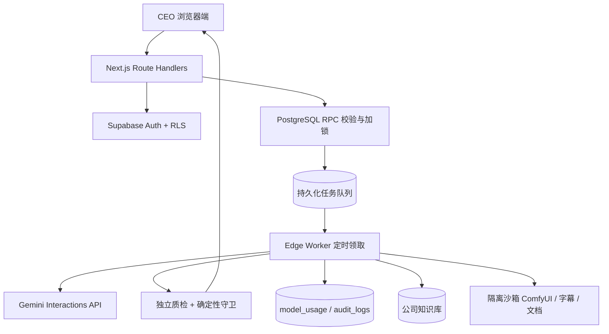

# AI Company OS

> 一个由 CEO 与 11 位 AI 高管组成的虚拟公司协作系统。CEO 下达业务目标，COS 拆解分工，专业高管各司其职，执行员工产出交付，经独立质检与 CEO 验收后归档为公司知识。


---

## 最初想做什么（以及它为什么是个好问题）

我的出发点不是「做个聊天机器人」，而是一个更大的设想：**让 AI 像一家公司那样运转——角色按层级分工，每个角色有明确的专业视角；人只在关键节点审批，其余自动完成。** 我甚至想过更小的闭环：给它一份竞品名单，它自己产出一份定位分析报告。

更远一步，我想做**从 0 自动搭建一条 AI 漫剧生产线**：自己找成熟技术、自己挑好用的 skill、自己搭工作流，人只在关键处点头。

我用 ChatGPT（Codex）把这些想法变成指令去搭。结果搭出来一个技术上很厚、但我看不太懂、而且「不够聪明」的系统——代码很复杂，产出却不像我想要的「公司」。这促使我停下来做一件事：**回去补技术认知，搞清楚 AI 的能力边界到底在哪，到底是我设想错了，还是实现偏了。**

这段「设想 → 落空 → 诊断 → 收窄」的过程，是这个项目最值得讲的部分。

## 我诊断出了什么

我把系统逐层拆开看，得出了一个反直觉的结论：**项目没有做烂，而是把「像一家公司」这个隐喻，实现成了一个任务流转系统。**

问题不在模型不够聪明，而在层级分工本身在制造信息损耗：

- 一句目标被拆成计划 → 工单 → 任务，**每拆一次丢一部分意图**；执行角色只看得到自己那张工单，看不到我真正想要什么。
- 「AI 质检」变成「另一个 AI 在没有明确标准的情况下评判前一个 AI」，结果往往是互相客套。
- 我想要的「角色更专业」，靠的其实不是职位名称——写「你是导演」「你是编剧」，模型能力没有任何变化。**真正的领域经验藏在专用工具和验收清单里，不在角色设定里。**

再加上对 AI 能力边界的研究，三个数字让我彻底想明白了：单步 95% 成功率，连续 10 步只剩约 60%；Agent 超过 30–40 步开始漂移、自相矛盾；生产系统每 3–5 步必设人工检查点。「从 0 自动搭完整条漫剧产线」恰好踩在每一条做不到上。

我把这次学习整理成了 [《AI 产品技术栈与能力边界 · 学习笔记》](docs/AI产品技术栈与能力边界_学习笔记.md)——七层技术栈、AI 能力边界、失败根因、以及「看任何 AI 项目该问的五个问题」。

## 我做的产品决策：从「大而自动」收窄为「小而可验证」

- **砍场景**：不追求「全自动虚拟公司」，先跑通一个能验收的文本任务闭环。
- **改架构**：从多层级工单流，转向 **generator–evaluator（一个做、一个按尺子判）**——而且判断者优先用程序规则，主观质量留给人。这条思路正好落在这个系统已有的「独立质检 + 确定性守卫 + CEO 验收」里。
- **改上下文**：让角色看到原始目标和已有结论，而不是一张孤零零的任务卡。
- **诚实标注边界**：跨部门自动路由、工具自主执行、端到端自动验收都没有上线，在 [roadmap 页面](ai-company-os-web/src/app/roadmap/page.tsx) 里明确标为后续规划。

**结论：层级不是问题，没有尺子的层级才是问题。** 我把它当成产品判断来做，而不是当成技术 bug 来修。

## 我在项目中的角色

**产品定义与体验设计由我完成，工程实现借助 ChatGPT 辅助搭建。**

我负责：角色体系、任务状态机、验收门禁、权限与审批模型、失败恢复策略，以及上面那次诊断与收窄决策。ChatGPT 负责把设计转成 Next.js / Supabase / Edge Function 的具体代码。

这是一种刻意选择的工作方式：把精力放在「该做什么、不该做什么、怎么算做完」，工程实现交给 AI 提效；**然后用验收文档和测试逐条核对它有没有偏离我的设计**——仓库里 31 个 SQL 测试和逐功能的验收记录，就是这么来的。

## 产品设计：三个关键决策

### 1. 先划边界，再谈能力

系统有 11 位高管（COS/CPO/CTO/CMO/CFO/COO/CDO/CHRO/CLO/CRO/CSO），但首页明确写着「职责说明是分工定位，不代表具备外部操作权限」。

- 项目协作室的讨论**只是建议**，不是审批、不是已验收知识、也不是可执行指令。
- 讨论**不能自行扩大工具权限**：付费、对外发布、敏感素材访问、执行新软件，一律走原有授权。
- 员工遇到阻塞只能向直属高管咨询**一次**，缺业务事实必须交回 CEO，不许编造。

这套边界不是写在提示词里，而是落在数据库约束、RPC 校验和 RLS 策略里。

### 2. 把「AI 说完成」变成「有证据的验收」

- 每次交付**钉住触发它的那条用户消息**（含澄清），质检与返工都带着这份固定上下文，不会把早先的要求弄丢。
- 独立质检用结构化 JSON 输出，但文档明确写「schema 输出不证明语义判断正确」——验证失败就标记 `needs_human`，不自动放行。
- 确定性守卫会数正文字符数与句末标点，可**否决**模型的通过判断，但不会把不确定的报告自动升级为通过。
- 项目阶段验收要求：所有关联工单已被 CEO 接受 + 前序阶段全部通过 + 端到端验证记录真实场景与失败恢复证据。

真实案例：COS 曾生成一份短视频文本方案，**前两版因「超出篇幅」和「暗示了系统不具备的能力」被打回，第三版才验收通过**。验收记录见 [`supabase/audits/task-center-20261111.md`](supabase/audits/task-center-20261111.md)。

### 3. 失败与恢复是一等公民

- 持久化任务队列：租约、幂等键、重试、退避、超时、失败原因、审计事件。
- 主模型超时后自动降级到备用模型——真实验收记录中，主模型 `gemini-3.8-flash` 失败，备用 `gemini-3.5-flash-lite` 在第 1 次尝试完成，全过程留下了 token 与状态记录。
- 浏览器角色不能直接写核心表；专属 RPC 校验归属、加锁、乐观版本号、请求键防重。
- 每个迁移都配 rollback 验证 SQL，测试在事务里跑完即回滚，不留合成数据。

## 系统架构



## 已跑通的能力闭环

| 能力                       | 状态    | 证据                                                                                     |
| ------------------------ | ----- | -------------------------------------------------------------------------------------- |
| 11 位高管独立对话，会话隔离、历史持久化    | 已上线   | [`multi-executive-chat-20261110.md`](supabase/audits/multi-executive-chat-20261110.md) |
| 异步任务队列：租约、重试、幂等、恢复       | 已上线   | [`async-live-acceptance.json`](supabase/audits/async-live-acceptance.json)             |
| COS 规划分工 → 执行员工 → CEO 验收 | 已上线   | [`project-center.md`](docs/project-center.md)                                          |
| 独立文本质检 + 一次限次返工          | 已上线   | [`quality-execution-evidence.md`](docs/quality-execution-evidence.md)                  |
| 项目协作室定向问答（每人 1 轮，最多 2 轮） | 已上线   | [`project-collaboration.md`](docs/project-collaboration.md)                            |
| 员工阻塞单次咨询                 | 已上线   | [`employee-consultation.md`](docs/employee-consultation.md)                            |
| 技能发现与来源/许可证核对            | 基础已具备 | [`find-skills-platform-integration.md`](docs/find-skills-platform-integration.md)      |
| 跨部门自动路由、通用工具执行、端到端自动验收   | 未上线   | [roadmap 页面](ai-company-os-web/src/app/roadmap/page.tsx)                               |

## 技术栈

- **前端**：Next.js 16 App Router、React、TypeScript、Tailwind CSS
- **后端与数据**：Supabase（PostgreSQL、Auth、Row Level Security、RPC、Edge Functions、Cron）
- **模型**：Google Gemini（`@google/genai` Interactions API，主备模型自动切换）
- **隔离执行**：Docker 沙箱（创意/文档/字幕/影视），ComfyUI 工作流
- **质量保障**：31 个 SQL 测试 + Node 测试脚本，CI 工作流校验技能沙箱、文档、影视、动效等链路

## 如何本地运行

```bash
# 应用位于子目录
cd ai-company-os-web
npm install
# 新建 .env.local，填入你自己的 Supabase URL / Anon Key / Service Role Key
# 与 GEMINI_API_KEY（变量名可参考 src/lib/ai/gemini.ts 与 src/lib/supabase/）
npm run dev                  # http://localhost:3000
```

数据库结构、迁移与测试在 [`supabase/`](supabase/)，按 `migrations/` 顺序执行；每个功能的验收与回滚测试在 [`supabase/tests/`](supabase/tests/)。

> 由于系统依赖真实的 Supabase 项目与 Gemini 额度，本仓库定位为**设计证据展示**而非开箱即用的产品。README 上方「已跑通的能力闭环」表格中的每份验收文档，都是可离线阅读的真实运行记录。

> 本仓库不包含任何 API Key、Supabase 连接凭证或 `.env` 文件。要实际运行，需自行创建 Supabase 项目与 Gemini API Key。

## 目录导览

```
ai-company-os/
├── ai-company-os-web/        # Next.js 应用（CEO 总部、会话、任务、项目、技能中心）
│   ├── src/app/              # 页面与 API Route Handlers
│   ├── src/components/       # 目标、任务、质检、协作等交互组件
│   └── scripts/              # Runner、技能发现、Provider 与测试脚本
├── supabase/
│   ├── migrations/           # 33 个增量迁移（均配 rollback 验证）
│   ├── functions/            # cto-task-worker 及各类业务桥接
│   ├── tests/                # 31 个 SQL / Python 测试
│   └── audits/               # 设计说明、上线验收记录、真实调用样例
├── sandbox/                  # Docker 隔离执行环境
├── skills/                   # 公司级技能定义
├── docs/                     # 产品增量说明、能力边界与学习笔记
│   └── AI产品技术栈与能力边界_学习笔记.md   # 项目复盘：诊断过程与 AI 能力边界
└── .github/workflows/        # CI 校验流水线
```

## 面试可讲的故事线

**主线（讲一个「我做砸了又救回来」的项目）：**

> 我最初想做一个全自动的虚拟公司，让 AI 按层级分工、只在关键点要人审批。用 AI 搭出来后，发现代码又大又复杂、产出却「不够聪明」。我没有继续加功能，而是回去补了 AI 能力边界的知识，诊断出问题不在模型、而在层级分工造成的信息衰减和验收标准缺失。于是我把它从「大而自动」收窄成「小而可验证」：砍到单场景、改成 generator–evaluator、把判断标准写成硬规则。这个项目最后的价值不在于它多智能，而在于我能说清「为什么该收窄、收窄到哪里」。

**三条佐证线：**

1. **产品判断力**：能说清「为什么这件事需要多个 agent 分工」——很多场景一个 agent 加几个工具就够，硬拆反而更慢更贵更易错。判断「该不该拆」比会写框架代码更稀缺。
2. **AI 辅助开发的真实样子**：不是一句话生成应用。我定义状态机和门禁，AI 写实现；再用验收文档和测试逐条核对有没有偏离。31 个 SQL 测试、逐功能验收记录就是证据。
3. **如何防止 AI 越界**：职责说明只是文字，真正的边界写在 RLS、RPC、租约与审批门禁里；讨论不能扩权，schema 输出不等于语义正确，模型通过可以被确定性规则否决。

> 关于这次诊断与学习的完整过程，见 [《AI 产品技术栈与能力边界 · 学习笔记》](docs/AI产品技术栈与能力边界_学习笔记.md)。

## 脱敏说明

本仓库为公开作品集版本，已移除 API Key、环境变量文件与本地绝对路径。项目采用真实产品设计叙事，但部署凭证、数据库地址与账号信息均不在仓库中。
