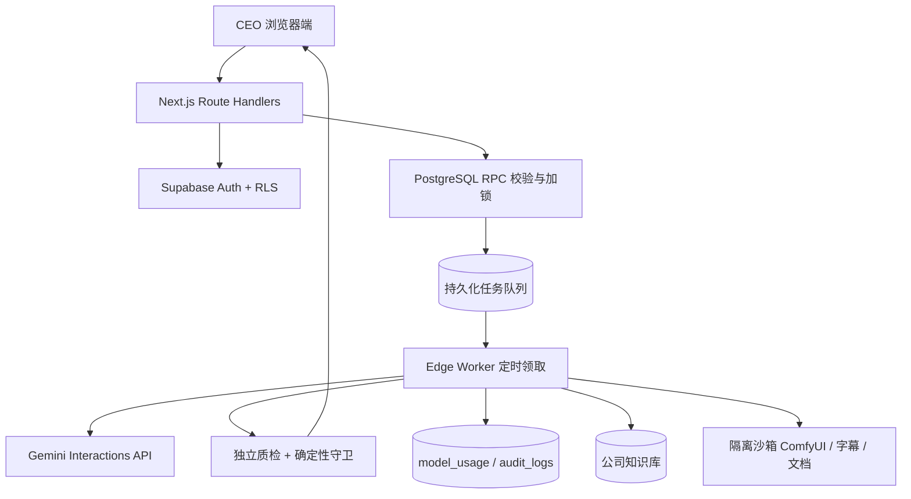

# AI Company OS

> 一个由 CEO 与 11 位 AI 高管组成的虚拟公司协作系统。CEO 下达业务目标，COS 拆解分工，专业高管各司其职，执行员工产出交付，经独立质检与 CEO 验收后归档为公司知识。


---

## 为什么做这个项目

市面上的「AI Agent 演示」大多是单个助手回答问题。我想验证的是一个更难的问题：**多个 AI 角色能不能像一家公司那样，围绕一个目标分工、交接、验收，并且过程可审计？**

真正难的不是让模型说话，而是三件事：

1. **边界**——AI 应该说什么是职责、什么只是说明文字；哪些动作必须等 CEO 批准；讨论不能自己扩大工具权限。
2. **证据**——「AI 说做完了」不等于做完了。交付要绑定原始请求版本，验收要由人和确定的规则共同把关。
3. **可靠性**——模型调用会超时、会失败、会返回不合规内容。任务必须能重试、能恢复、能留下审计轨迹。

这个系统就是围绕这三点搭出来的。

## 我在项目中的角色

**产品定义与体验设计由我完成，工程实现借助 ChatGPT 辅助搭建。**

我负责的部分：角色体系与职责边界、任务状态机与验收门禁、权限与审批模型、失败恢复策略、产品路线图与能力边界的诚实标注。ChatGPT 负责把设计方案转成 Next.js / Supabase / Edge Function 的具体代码。

这是一种刻意选择的工作方式：把精力放在「该做什么、不该做什么、怎么算做完」，工程实现交给 AI 提效。**落地结果与最初设想存在差距**——最主要的一点是，最初设想的是更自主的多 Agent 协作，实际落地时主动收窄为「有边界、有证据、CEO 可审计的有限协作」。跨部门自动路由、工具自主执行、端到端自动验收都没有上线，这些在 [roadmap 页面](ai-company-os-web/src/app/roadmap/page.tsx) 里明确标为后续规划。

我认为这个收窄是正确的产品判断：在可靠性与成本尚未验证之前，让 AI「少做一点但每步可核对」，比「看起来很 autonomous」更有价值。相关取舍逐条记录在 [`docs/`](docs/) 与 [`supabase/audits/`](supabase/audits/) 的增量文档里。

## 产品设计：三个关键决策

### 1. 先划边界，再谈能力

系统有 11 位高管（COS/CPO/CTO/CMO/CFO/COO/CDO/CHRO/CLO/CRO/CSO），但首页明确写着「职责说明是分工定位，不代表具备外部操作权限」。

- 项目协作室的讨论**只是建议**，不是审批、不是已验收知识、也不是可执行指令。
- 讨论**不能自行扩大工具权限**：付费、对外发布、敏感素材访问、执行新软件，一律走原有授权。
- 员工遇到阻塞只能向直属高管咨询**一次**，缺业务事实必须交回 CEO，不许编造。

这套边界不是写在提示词里，而是落在数据库约束、RPC 校验和 RLS 策略里。

### 2. 把「AI 说完成」变成「有证据的验收」

- 每次交付**钉住触发它的那条用户消息**（含澄清），质检与返工都带着这份固定上下文，不会把早先的要求弄丢。
- 独立质检用结构化 JSON 输出，但文档明确写「schema 输出不证明语义判断正确」——验证失败就标记 `needs_human`，不自动放行。
- 确定性守卫会数正文字符数与句末标点，可**否决**模型的通过判断，但不会把不确定的报告自动升级为通过。
- 项目阶段验收要求：所有关联工单已被 CEO 接受 + 前序阶段全部通过 + 端到端验证记录真实场景与失败恢复证据。

真实案例：COS 曾生成一份短视频文本方案，**前两版因「超出篇幅」和「暗示了系统不具备的能力」被打回，第三版才验收通过**。验收记录见 [`supabase/audits/task-center-20261111.md`](supabase/audits/task-center-20261111.md)。

### 3. 失败与恢复是一等公民

- 持久化任务队列：租约、幂等键、重试、退避、超时、失败原因、审计事件。
- 主模型超时后自动降级到备用模型——真实验收记录中，主模型 `gemini-3.8-flash` 失败，备用 `gemini-3.5-flash-lite` 在第 1 次尝试完成，全过程留下了 token 与状态记录。
- 浏览器角色不能直接写核心表；专属 RPC 校验归属、加锁、乐观版本号、请求键防重。
- 每个迁移都配 rollback 验证 SQL，测试在事务里跑完即回滚，不留合成数据。

## 系统架构



## 已跑通的能力闭环

| 能力 | 状态 | 证据 |
|---|---|---|
| 11 位高管独立对话，会话隔离、历史持久化 | 已上线 | [`multi-executive-chat-20261110.md`](supabase/audits/multi-executive-chat-20261110.md) |
| 异步任务队列：租约、重试、幂等、恢复 | 已上线 | [`async-live-acceptance.json`](supabase/audits/async-live-acceptance.json) |
| COS 规划分工 → 执行员工 → CEO 验收 | 已上线 | [`project-center.md`](docs/project-center.md) |
| 独立文本质检 + 一次限次返工 | 已上线 | [`quality-execution-evidence.md`](docs/quality-execution-evidence.md) |
| 项目协作室定向问答（每人 1 轮，最多 2 轮） | 已上线 | [`project-collaboration.md`](docs/project-collaboration.md) |
| 员工阻塞单次咨询 | 已上线 | [`employee-consultation.md`](docs/employee-consultation.md) |
| 技能发现与来源/许可证核对 | 基础已具备 | [`find-skills-platform-integration.md`](docs/find-skills-platform-integration.md) |
| 跨部门自动路由、通用工具执行、端到端自动验收 | 未上线 | [roadmap 页面](ai-company-os-web/src/app/roadmap/page.tsx) |

## 技术栈

- **前端**：Next.js 16 App Router、React、TypeScript、Tailwind CSS
- **后端与数据**：Supabase（PostgreSQL、Auth、Row Level Security、RPC、Edge Functions、Cron）
- **模型**：Google Gemini（`@google/genai` Interactions API，主备模型自动切换）
- **隔离执行**：Docker 沙箱（创意/文档/字幕/影视），ComfyUI 工作流
- **质量保障**：31 个 SQL 测试 + Node 测试脚本，CI 工作流校验技能沙箱、文档、影视、动效等链路

## 如何本地运行

```bash
# 应用位于子目录
cd ai-company-os-web
npm install
# 新建 .env.local，填入你自己的 Supabase URL / Anon Key / Service Role Key
# 与 GEMINI_API_KEY（变量名可参考 src/lib/ai/gemini.ts 与 src/lib/supabase/）
npm run dev                  # http://localhost:3000
```

数据库结构、迁移与测试在 [`supabase/`](supabase/)，按 `migrations/` 顺序执行；每个功能的验收与回滚测试在 [`supabase/tests/`](supabase/tests/)。

> 由于系统依赖真实的 Supabase 项目与 Gemini 额度，本仓库定位为**设计证据展示**而非开箱即用的产品。README 上方「已跑通的能力闭环」表格中的每份验收文档，都是可离线阅读的真实运行记录。

> 本仓库不包含任何 API Key、Supabase 连接凭证或 `.env` 文件。要实际运行，需自行创建 Supabase 项目与 Gemini API Key。

## 目录导览

```
ai-company-os/
├── ai-company-os-web/        # Next.js 应用（CEO 总部、会话、任务、项目、技能中心）
│   ├── src/app/              # 页面与 API Route Handlers
│   ├── src/components/       # 目标、任务、质检、协作等交互组件
│   └── scripts/              # Runner、技能发现、Provider 与测试脚本
├── supabase/
│   ├── migrations/           # 33 个增量迁移（均配 rollback 验证）
│   ├── functions/            # cto-task-worker 及各类业务桥接
│   ├── tests/                # 31 个 SQL / Python 测试
│   └── audits/               # 设计说明、上线验收记录、真实调用样例
├── sandbox/                  # Docker 隔离执行环境
├── skills/                   # 公司级技能定义
├── docs/                     # 产品增量说明与能力边界
└── .github/workflows/        # CI 校验流水线
```

## 面试可讲的三条故事线

1. **需求校准**：我设计了「多 Agent 自主协作」的设想，落地中发现可靠性与成本不成立，主动收窄为「有边界、有证据、CEO 可审计」的闭环，并把未做的部分公开标注。
2. **AI 辅助开发的真实的样子**：不是一句话生成应用。我定义状态机、门禁和权限模型，AI 写实现；我再用验收文档和测试逐条核对它有没有偏离设计。
3. **如何防止 AI 越界**：职责说明只是文字，真正的边界写在 RLS、RPC、租约与审批门禁里；讨论不能扩权，schema 输出不等于语义正确，模型通过可以被确定性规则否决。

## 脱敏说明

本仓库为公开作品集版本，已移除 API Key、环境变量文件与本地绝对路径。项目采用真实产品设计叙事，但部署凭证、数据库地址与账号信息均不在仓库中。
